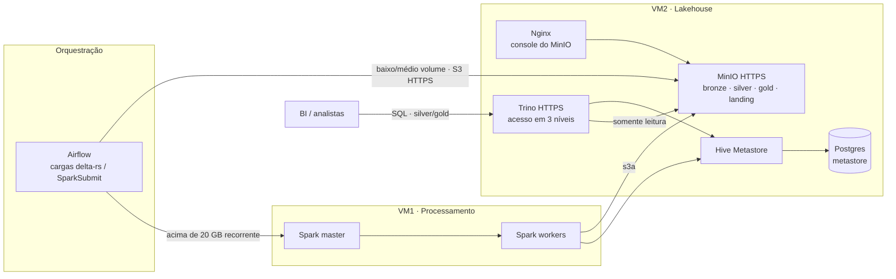

# Lakehouse On-Prem Stack

Infraestrutura de um lakehouse em servidores próprios, em Docker Compose —
**MinIO (S3) + Delta Lake + Hive Metastore + Trino + Spark** — separada em
duas VMs, com acesso controlado por perfil e scripts de operação para manter o
repositório de dados saudável.

> Versão genérica de um projeto real. Servidores, IPs, domínios, nomes de
> projeto e contas foram substituídos por valores fictícios. Nenhum segredo
> está no repositório.

## Lakehouse no modelo da Databricks, com peças de código aberto

A arquitetura é a mesma popularizada pela Databricks (Delta Lake + camadas
medalhão), montada com componentes de código aberto:

| Papel | Na Databricks | Aqui |
|---|---|---|
| Armazenamento | S3 / ADLS | MinIO |
| Formato de tabela | Delta Lake | Delta Lake |
| Catálogo | Unity Catalog | Hive Metastore |
| Consulta SQL | Databricks SQL | Trino |
| Organização | Medalhão | bronze / silver / gold |

## Problema

Bases de várias instituições/sistemas precisavam virar indicadores de gestão
sem nuvem pública disponível e com dados sensíveis (LGPD). Requisitos:

- armazenamento barato e versionado para as camadas **bronze / silver / gold**;
- SQL para engenharia e BI **sem** dar a analistas acesso ao dado bruto;
- nenhum segredo em `.env`, no Git ou na linha de comando.

## O que a plataforma entrega

| Entrega | Ganho |
|---|---|
| Topologia em **2 VMs** | VM1: Spark (master e workers). VM2: MinIO, Hive Metastore (+ Postgres) e Trino. Processamento isolado do armazenamento e do catálogo |
| Só plataforma | Nenhuma regra de negócio: os projetos são montados em modo somente leitura em `/opt/delta-projects/<projeto>` pela integração contínua |
| Controle de acesso do Trino em **3 níveis** | `admin` (tudo), `engenharia` (bronze/silver/gold), `analista` (só silver/gold). Usuários com hash bcrypt, gerados por script — senha exibida uma vez, direto para o cofre |
| **Políticas do MinIO de menor privilégio** | Trino e Hive só leem (políticas internas, registradas na inicialização). Contas de carga recebem política gerada por `scripts/minio/set-user.sh`, limitada a bucket/prefixo e sem `DeleteObject` por padrão. `spark-ingest.json` e `spark-process.json` são modelos para as contas de ingestão e processamento, as únicas que apagam objetos — reescrita e VACUUM de tabela Delta exigem isso. A conta de consulta **não consegue gravar** |
| TLS no armazenamento e na consulta | MinIO em HTTPS com certificado próprio (`gen-tls-certs.sh`), truststore da JVM com permissão `600` e dono = UID do Trino, Trino em HTTPS. O Spark da VM1 acessa o MinIO por HTTPS confiando no mesmo certificado |
| Superfície mínima | Portas publicadas em `127.0.0.1` por padrão; Hive Thrift nunca publicado fora da rede Docker; console do MinIO só via proxy Nginx com cabeçalhos de endurecimento |
| Segredos **um por arquivo** | `.env` só com endereço de escuta, portas, domínio e opções; credenciais em `.env_secrets/` (`700`/`600`) montadas como Docker secrets |
| Validação de acesso documentada | Ex.: analista em bronze = `Access Denied`; conta de consulta gravando no bucket = `AccessDenied` |
| Reconciliação genérica | `scripts/reconciliation.py` compara a contagem e a data mais recente entre a fonte (JDBC, arquivo ou Delta) e o destino Delta, com tolerância por tabela — cada projeto só fornece um YAML |
| Scripts de operação do armazenamento | Relatório de inchaço por tabela Delta (espaço recuperável por VACUUM), auditoria das transações, remoção definitiva de versões excluídas, análise de marcadores de exclusão, VACUUM via `mc` |

## Motor de processamento: quando usar Spark

O contrato da plataforma é a **tabela Delta no MinIO**. Quem grava a tabela é
escolha de cada carga, não da plataforma — por isso dá para começar pequeno e
só ligar o cluster quando o volume pedir.

| | Nó único (delta-rs) | Spark |
|---|---|---|
| Volume | Baixo a médio: até ~20 GB por carga | Alto: acima de 20 GB, processados repetidamente |
| Onde roda | No próprio worker do orquestrador (processo Python) | Cluster da VM1, via `SparkSubmit` |
| Infraestrutura necessária | Só a VM2 | VM1 + VM2 |
| Custo de operar | Nenhum serviço a mais; sobe e termina com a carga | Master, workers, JARs, memória e controle de acesso para manter |
| Processamento contínuo | Não | Sim (Structured Streaming) |

Regra prática: **o corte é ~20 GB em carga recorrente.** Abaixo disso, um
processo em nó único resolve sem cluster para manter; acima, e rodando
seguidas vezes, o Spark passa a compensar o custo de operação. Uma carga
grande e pontual não justifica, sozinha, subir o cluster.

DuckDB é a referência prática dessa faixa de baixo a médio volume: um motor
de nó único que lê Delta direto do repositório de dados, sem cluster. Ele não
faz parte desta plataforma; serve de parâmetro para o que cabe em uma máquina.

### O que o Spark resolve em alto volume

- **Dado maior que a memória.** O Spark divide a carga em partições e
  processa uma parte por vez; o que não cabe em memória vai para disco em vez
  de derrubar o processo. Em nó único, a mesma carga depende de caber na RAM.
- **Junções e agregações grandes.** O Spark redistribui as chaves entre
  partições (shuffle), e a execução adaptativa de consultas (ligada em
  `spark-defaults.conf.template`) ajusta o plano durante a execução: parte de
  200 partições, junta as pequenas, troca a estratégia de junção e trata
  chaves desbalanceadas.
- **Escala horizontal.** Faltou capacidade, o segundo worker da VM1 sobe com
  `--profile scale` — a carga não muda. Em nó único, a saída é uma máquina
  maior.
- **Falha parcial.** Se uma tarefa falha, o Spark reexecuta só aquela
  partição, não a carga inteira. Em cargas longas e recorrentes, isso é a
  diferença entre perder minutos e perder a janela.
- **Arquivos saudáveis no armazenamento.** `optimizeWrite` e `autoCompact` do
  Delta (também ligados) evitam a proliferação de arquivos pequenos, que é o
  que degrada leitura e consulta em tabelas grandes.

O preço é a operação: master, workers, JARs, memória por executor e controle
de acesso passam a ser coisas a manter. Abaixo do corte, esse custo não se
paga.

### Referências

- Apache Spark — [Cluster Mode Overview](https://spark.apache.org/docs/latest/cluster-overview.html): driver, executores e gerenciador de cluster.
- Apache Spark — [Tuning Spark](https://spark.apache.org/docs/latest/tuning.html): memória, paralelismo e serialização.
- Apache Spark — [Spark SQL Performance Tuning](https://spark.apache.org/docs/latest/sql-performance-tuning.html): execução adaptativa, partições e estratégias de junção.
- Apache Spark — [Spark Standalone Mode](https://spark.apache.org/docs/latest/spark-standalone.html): o modo de cluster usado na VM1.
- Delta Lake — [Optimizations](https://docs.delta.io/latest/optimizations-oss.html) e [Best practices](https://docs.delta.io/latest/best-practices.html): compactação, escrita otimizada e particionamento.
- Apache Hadoop — [S3A Performance](https://hadoop.apache.org/docs/stable/hadoop-aws/tools/hadoop-aws/performance.html): leitura e escrita em armazenamento de objetos compatível com S3.
- Zaharia et al., *Resilient Distributed Datasets: A Fault-Tolerant Abstraction for In-Memory Cluster Computing*, NSDI 2012: o modelo de recomputação por partição.
- Armbrust et al., *Spark SQL: Relational Data Processing in Spark*, SIGMOD 2015: o otimizador por trás do DataFrame/SQL.

O que não muda com o motor:

- **O registro da tabela é do Delta.** Esquema, versões e arquivos válidos
  ficam no log de transações gravado pela própria carga. O Trino não participa
  da escrita: é o motor analítico de consulta da equipe.
- A troca é por carga, não por projeto: os dois caminhos gravam Delta nos
  mesmos buckets e o Trino consulta o resultado do mesmo jeito.
- A conta de serviço da carga é criada por `set-user.sh`, com leitura e
  escrita só nos buckets/prefixos que ela usa.
- Reconciliação, relatório de inchaço e VACUUM operam sobre a tabela Delta,
  independentemente de quem a escreveu.

Este repositório entrega a imagem e o compose do Spark. O caminho de nó único
não exige nada daqui além da VM2: a biblioteca (`deltalake`) fica no ambiente
do orquestrador.

## Arquitetura



## Estrutura

```
docker-compose.yml                     # ambiente local completo, com Kafka + Kafka UI
docker-compose.lakehouse-vm2.yml       # VM2: MinIO + Hive + Trino
docker-compose.spark-vm1.yml           # VM1: Spark
config/
  hive/      minio/      postgres/     spark/     trino/
  local/                               # Hive e catálogo Trino do ambiente local (HTTP, sem autenticação)
  minio/policies/*.json                # políticas de menor privilégio
  trino/rules.json                     # regras de acesso por grupo
scripts/
  reconciliation.py                    # reconciliação fonte × Delta
  minio/                               # TLS, contas, auditoria e limpeza
  minio/set-user.sh                    # contas MinIO (política por bucket/prefixo)
  trino/set-user.sh                    # usuários Trino (bcrypt + grupo de acesso)
env.*.example                          # só nomes de variáveis
```

## Como rodar (local)

O ambiente local existe para explorar a arquitetura em uma máquina só: MinIO
em HTTP, Trino sem autenticação e credenciais por variável de ambiente, com
configurações próprias em `config/local/`. Os controles de segurança descritos
acima valem para os composes das VMs.

```bash
# 1. Segredos (fora do Git): crie env_secrets/stack.secrets com as variáveis
#    usadas pelo docker-compose.yml (nomes de referência em env.*.example)
mkdir -p env_secrets && touch env_secrets/stack.secrets

# 2. Subir
make up
make ps

# 3. SQL sobre Delta
make trino-cli
#   SHOW SCHEMAS FROM delta;

# 4. Reconciliação de um projeto
make run-reconcile CONFIG=/opt/delta-projects/<projeto>/reconciliation.yml
```

Para rodar em 2 VMs, use `docker-compose.spark-vm1.yml` e
`docker-compose.lakehouse-vm2.yml` (variáveis em `env.*.example`).

### Contas e usuários (VM2)

Infraestrutura e contas são passos separados: a inicialização cria buckets e
políticas internas; as contas saem destes dois scripts, que mostram a
credencial uma única vez.

```bash
# MinIO — contas de serviço internas (gravam em .env_secrets/)
./scripts/minio/set-user.sh trino --write-secrets
./scripts/minio/set-user.sh hive  --write-secrets

# MinIO — conta de carga: lê landing, escreve bronze (política gerada na hora)
./scripts/minio/set-user.sh svc_h3w6 --read landing --write bronze

# Trino — usuário + nível de acesso (admin | engenharia | analista)
./scripts/trino/set-user.sh usr_k4t9 admin
./scripts/trino/set-user.sh usr_p8d3 analista
```

Como conferir que o acesso ficou certo:
[`config/minio/POLICIES-VERIFICACAO.md`](config/minio/POLICIES-VERIFICACAO.md) e
[`config/trino/ACL-VERIFICACAO.md`](config/trino/ACL-VERIFICACAO.md).

### Exemplo de `reconciliation.yml`

```yaml
source:
  jdbc:
    host: postgres
    port: 5432
    database: app
    user_env: APP_DB_USER
    password_env: APP_DB_PASSWORD

defaults:
  tolerance: 0

datasets:
  - name: pedidos
    source:
      table: public.pedidos
    target:
      path: s3a://silver/pedidos
    tolerance: 5
    freshness_column: updated_at
```

## Decisões

- **Plataforma ≠ projeto.** A plataforma não conhece nomes de projeto; a
  integração contínua monta cada repositório em um volume somente leitura e
  as cargas gravam só no MinIO/Postgres.
- **Infraestrutura ≠ contas.** A inicialização do MinIO cria buckets e
  políticas; usuários e contas de serviço são criados por `set-user.sh`, com o
  nível de acesso escolhido na criação.
- **Hive Thrift não tem autenticação de aplicação** — por isso não é publicado
  fora da rede Docker; só o Trino fala com ele.
- **Regras de acesso do Trino: a primeira que casa vence.** `execute` e `view`
  de consultas ficam na mesma regra por grupo, senão o cliente falha com
  `Cannot view query`.

## Dimensionamento de referência

| Componente | Local | Ambiente maior |
|---|---|---|
| Spark workers | 2 × 2 CPU / 2 GB | 4+ × 4 CPU / 8 GB |
| MinIO | 1 nó | 4 nós (com redundância entre discos) |
| PostgreSQL | 1 instância | primário + réplica |
